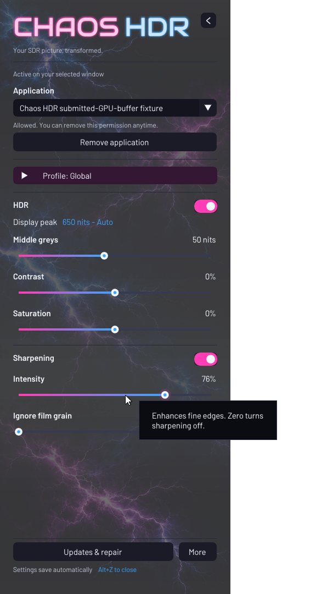

# 

## 0.4.2 — overlay rendering fix

A full-height, translucent Alt+Z sidebar with neon lettering, animated
lightning, smooth transitions and independent HDR and sharpening controls.
The exposed desktop stays usable, and KDE screenshots can include the open
sidebar. Optional reduced motion and accessible native controls are under **More**.

Includes the 0.4.0 improvements to display tracking, settings persistence, update
rollback and GPU-resource cleanup. Matched local tests measured approximately
0.27 ms of GPU processing at 1440p and 0.49 ms at 4K. See the [release notes](docs/releases/0.4.0.md)
for results, limitations and the cold-rebuild tradeoff.

**[Download the packaged installer](https://github.com/chaosfox26/chaos-hdr/releases/download/v0.4.2/Chaos-HDR-CachyOS.run)** · [0.4.2 release notes](docs/releases/0.4.2.md)

0.4.2 fixes black rectangles replacing the sidebar's text and controls when
an unsupported emoji font is selected or shared graphics state disrupts a font
upload. Font rebuilding now preserves the working fonts if a fallback fails.
The HDR processing path is unchanged.
Fresh-system installation and new-login acceptance remain unverified.

## Current interface



The current sidebar, captured against black in an isolated test desktop using
a synthetic application. Alt+Z slides it in and out; the live lightning and
title effects are animated.

## About Chaos HDR

Experimental NVIDIA TrueHDR and sharpening for selected SDR application windows on KDE Wayland.

**Created by Chaos Fox with the help of OpenAI Codex.**

Chaos HDR is my implementation of the workflow I wanted: launch an application normally, open Alt+Z, explicitly allow its window, and adjust HDR without changing its files. It builds on NVIDIA’s engine and the Linux graphics community’s work. Other projects explore related goals using different methods; this project does not claim to be the first or to replace them.

**License:** Chaos HDR's original code and documentation are licensed under [GNU GPL version 2 only](LICENSE) (`GPL-2.0-only`), copyright Chaos Fox. Third-party components retain their own licenses; this grant does not relicense NVIDIA's engine, SDK or other dependencies.

**Experimental source release:** fresh-system installation validation is still pending. The KWin/NGX combined-binary licensing question remains unresolved; the source installer downloads dependencies upstream and builds locally. This release does not claim permission to redistribute the combined binary. See [third-party notices](THIRD_PARTY_NOTICES.rst). No universal compatibility or performance guarantee is implied.

## Start here

- **Install:** paste this one command into a terminal and press Enter:

```sh
curl -fsSL https://github.com/chaosfox26/chaos-hdr/releases/download/v0.4.2/install.sh | bash
```

- **Supported target:** CachyOS/Arch, KDE Plasma Wayland, compatible NVIDIA RTX GPU/driver, HDR enabled in KDE. Fresh-machine installation is not yet verified.
- **Open controls:** Alt+Z → choose a window → Allow application → choose HDR and sharpening.
- **Uninstall:** `~/.local/bin/chaos-hdr-uninstall`
- **Delete everything as well:** `~/.local/bin/chaos-hdr-uninstall --purge` — permanently deletes the complete project and saved settings.

The public command downloads and runs setup directly from GitHub, then handles dependencies, the native build and login startup on the current CachyOS/Arch KDE Wayland target. Users do not need to save an installer manually, change executable permissions or run extra setup commands. See [installation and removal](docs/installation.md) for requirements and details.

## What it does

- NVIDIA TrueHDR conversion with debanding, plus adjustable sharpening.
- Live Alt+Z controls, automatic KDE display-peak detection and named picture profiles.
- Explicit application approval without executable browsing; one selected window is processed at a time.
- Direct submitted GPU-buffer processing inside KWin, outside the application process.
- Event-driven idle operation and a watchdog only while a target has HDR enabled.
- Daily GitHub release checks, update notifications and user-initiated update/repair controls.
- No first-party telemetry, account inspection or normal frame recording.

## Tested GPU processing time

With **HDR and sharpening enabled**, the tested implementation measured the
following median GPU times. These local synthetic-scene tests recorded about
300 completed frames per mode on October 23, 2026 using 0.4.0. The 0.4.2 font
fix leaves the HDR processing and shaders unchanged; these timings have not
been remeasured for 0.4.2.

| Resolution | Processing, sidebar closed | Processing, sidebar open | Overlay drawing, sidebar open |
|---|---:|---:|---:|
| 1440p / QHD ("2K") — 2560 × 1440 | **0.269 ms** | 0.275 ms | 0.018 ms |
| 4K / UHD — 3840 × 2160 | **0.490 ms** | 0.490 ms | 0.022 ms |

Processing includes GPU input preparation, sharpening and NVIDIA TrueHDR.
Overlay drawing is measured separately; the closed sidebar has no overlay
draw. These are GPU processing measurements, not total input-to-display latency
or a guarantee for every GPU and game. See [performance and testing](docs/performance.md)
for measurement scope and the [0.4.0 results](docs/releases/0.4.0.md) for the
baseline comparison and recovery tradeoffs.

## Documentation

| Page | What you will find |
|---|---|
| [Installation and removal](docs/installation.md) | Requirements, one-command setup/removal, updates and file locations |
| [User guide](docs/user-guide.md) | Window approval, controls, profiles and everyday operation |
| [Architecture and dependencies](docs/architecture.md) | Exact KWin hooks, GPU data flow and why components are needed |
| [Compatibility and API mapping](docs/compatibility.md) | Graphics routes, fast-path requirements and testing limits |
| [Performance and testing](docs/performance.md) | What measurements mean and how to make useful comparisons |
| [Privacy](docs/privacy.md) | Transient data, saved configuration and production/development boundaries |
| [Troubleshooting](docs/troubleshooting.md) | Unsupported windows, KWin updates, services and known issues |
| [Contributing](docs/contributing.md) | Source layout, development checks and release practices |
| [Credits and related projects](docs/credits.md) | Dependencies, reference material and alternatives using different methods |
| [Development reference](Chaos%20HDR%20development.md) | Detailed component notes and explanations moved from source comments |
| [Third-party notices](THIRD_PARTY_NOTICES.rst) | Upstream terms and unresolved licensing boundaries |

## Community context

Linux HDR, compositor filtering and native Linux NVIDIA TrueHDR integrations already have prior work. Please explore [LinRTX-OBS](https://github.com/NoID1290/LinRTX-OBS), [KWin Effect Shaders](https://github.com/kevinlekiller/kwin-effect-shaders), [KWin Effect Upscale](https://github.com/JensKSP/kwin-effect-upscale), [Gamescope](https://github.com/ValveSoftware/gamescope) and [CachyOS-Auto-HDR](https://github.com/Aurion8/CachyOS-Auto-HDR). The [credits and methods comparison](docs/credits.md) explains their different roles and links further work.

These links acknowledge and help readers discover other work. They do not imply endorsement, partnership, code reuse or performance equivalence. NVIDIA TrueHDR remains NVIDIA’s separately licensed engine; Chaos HDR is an independent integration.

## Current boundaries

The fast path requires compatible buffers and leaves unsupported windows unchanged. VR output and universal anti-cheat approval are not established. The panel uses regional input handling; KDE screenshot selection takes priority over its controls. See [compatibility](docs/compatibility.md) and [troubleshooting](docs/troubleshooting.md).
